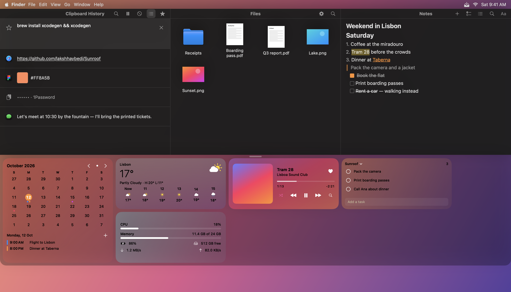
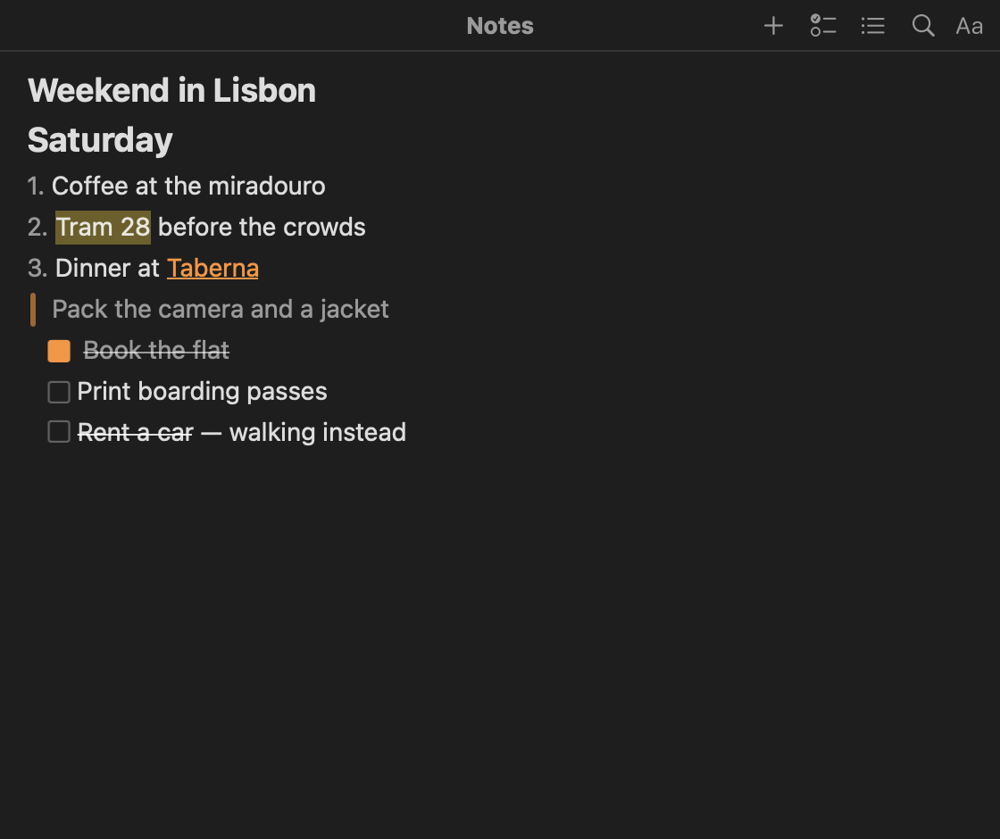
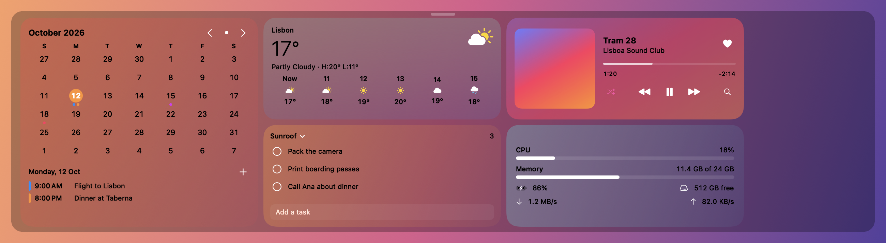
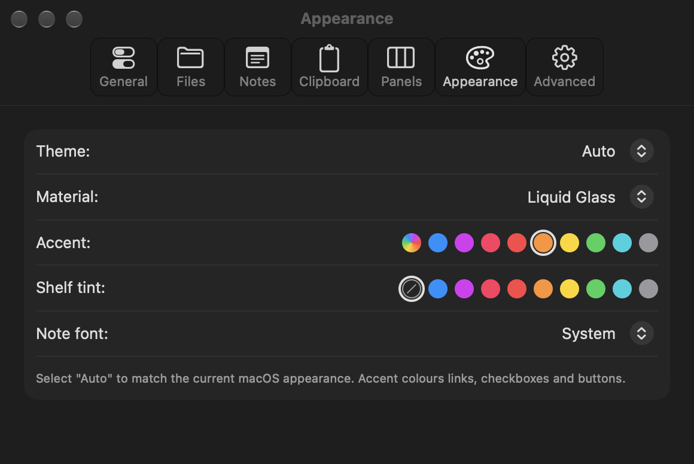

<p align="center"></p>

<p align="center"><b>Your clipboard, files, notes and widgets — one scroll away.</b><br>
Move the pointer to the very top of the screen and scroll down: a strip slides open with everything you keep reaching for.</p>

<p align="center">
  <a href="https://github.com/lakshhaybedi/Sunroof/releases/latest">Download</a> ·
  <a href="#features">Features</a> ·
  <a href="#-widgets">Widgets</a> ·
  <a href="#keyboard-shortcuts">Shortcuts</a> ·
  <a href="#build-from-source">Build</a>
</p>



## Why Sunroof

Sunroof lives above your menu bar and stays out of the way. No Dock icon, no window to manage — just a shelf that opens from the top edge of any screen, over any app, in any Space (full-screen apps included), and closes the way it opened.

It's a native Swift / SwiftUI app for macOS 26 and later. It's fast and light: about **20 MB of memory at idle, 0 % CPU and no idle wake-ups**.

## Features

### 📋 Clipboard
- History of the last 10, 25 or 50 things you copied: text, rich text, links, images, files and colours, each with the app it came from
- Click to copy again, or press **⏎** to paste straight into the app you were using (**⌥⏎** pastes as plain text, **⌘1–9** quick-pastes)
- **Favourites** you star are kept forever, in a folder you choose, so they can sync between Macs
- Search, pause, and clear in one click
- Passwords from 1Password and other password managers show as `••••••` and are **never written to disk**; add any app to hide or ignore it

### 🗂 Files
- A drop zone for things you need nearby: drag in to **move**, **⌥** to copy, **⌘⌥** to make an alias
- Drag images and links straight in from your browser; drag anything back out to any app
- Icons or list, sort by name, kind or date, open folders inside the shelf, **Space** for Quick Look
- Search inside subfolders, optional **auto-cleanup** (to the Trash) and a **screenshot catcher**

### 📝 Notes


- Plain **Markdown files** in a folder you choose, readable in any editor and easy to sync
- **Live styling**: the markdown hides as you type: headings, **bold**, *italic*, ~~strike~~, ==highlight==, `code`, quotes and links
- **Checklists you click** (type `[]` and a space), bullet lists and numbered lists that renumber themselves, with **Tab** to indent
- Paste images inline; select text for a floating formatting bar; **⌘K** to add a link
- `||secret||` hides text until you click it
- Pin notes, search everything, and **float any note as a sticky** that stays on top
- **Clean Up Note** (**⌘⇧K** or ✨): turns pasted or imported plain text into tidy markdown: bullets, numbered lists, checkboxes, headings, and **Name -** / **Label:** prefixes in bold
- Changes from another Mac never overwrite unsaved work; a conflict copy is kept instead
- Coming from Unclutter? `scripts/import-unclutter-notes.py` copies all your Unclutter notes across

<br clear="right">

### 🧩 Widgets


A row of widgets floats under the shelf on frosted glass. Drag one onto another to rearrange them, right-click to resize or remove, and use **＋** to add more.
- **Calendar**: month view with your events and the day's agenda (Apple Calendar)
- **Weather**: now, the next hours and the week, for a city you pick or your location ([Open-Meteo](https://open-meteo.com), no account needed)
- **Music**: Apple Music or Spotify, with album art, a scrubber, shuffle, ♥ favourites and search
- **Tasks**: Apple Reminders, or Sunroof's own list kept in a note
- **System stats**: CPU, memory, battery, disk and network

Widgets only run while the shelf is open, so they cost nothing the rest of the time.

### ✨ Everywhere
- **⌘⇧F** searches clipboard, files and notes at once
- **Send to Note** sends any clip into a note
- Open the shelf your way: **scroll down**, **hold a key** or **pause** at the top edge, drag a file up, or set a **hotkey**
- Drag a column's title to **rearrange** the three panels, and resize them to taste
- **Accent colour**, **shelf tint**, **note font**, Liquid Glass or solid, light, dark or auto



## Keyboard shortcuts

| Where | Keys | Action |
|---|---|---|
| Anywhere | your hotkey (Settings › General) | Open / close the shelf |
| Shelf | **⌘⇧F** | Search clipboard, files and notes |
| Shelf | **Esc** · scroll up at the top | Close |
| Clipboard | **⏎** / **⌥⏎** | Paste / paste as plain text |
| Clipboard | **⌘1–9** · **⌘C** · **⌘S** · **⌫** · **Space** | Quick paste · copy · star · delete · Quick Look |
| Files | **⏎** · **⌘O** · **Space** · **⌘⌫** · **⌘↑** | Rename · open · Quick Look (Space again closes, arrows move) · Trash · up a folder |
| Files | **⌘A** · **⌘C** | Select all · copy files |
| Files | **⌘1** / **⌘2** | Icons / list |
| Notes | **⌘B** **⌘I** **⌘U** · **⇧⌘X** · **⇧⌘H** · **⌘E** · **⌘K** | Bold, italic, underline · strike · highlight · code · link |
| Notes | **⌘1–3** · **⇧⌘8** · **⇧⌘7** · **⇧⌘L** | Headings · bullets · numbers · checklist |
| Notes | **⌘⏎** · **⌘⌥↑/↓** · **Tab** / **⇧Tab** | Tick a checkbox · move a line · indent |
| Notes | **⌘-click** a link | Open it |
| Notes | **⌘⇧K** | Clean Up Note |

## Performance

Measured with `scripts/perf.sh` on Apple Silicon (Release build, before widgets were added; widgets do no work while the shelf is closed):

| | Memory | CPU at rest | Idle wake-ups | Threads |
|---|---|---|---|---|
| Shelf closed | 22 MB | 0.0 % | 0 | 3 |
| Shelf open | 47 MB | 0.0 % | 0 | 5 |

## Install

Download **Sunroof-x.y.z.dmg** from [Releases](https://github.com/lakshhaybedi/Sunroof/releases/latest), open it and drag **Sunroof** to **Applications**.

> **Unsigned builds:** until releases are signed and notarized, macOS blocks the first launch. Try to open Sunroof once, then go to **System Settings › Privacy & Security** and click **Open Anyway**.

Sunroof needs **macOS 26** or later and runs natively on Apple Silicon and Intel.

## Permissions & privacy

- **Accessibility** is used only to paste for you (⏎ in the clipboard). Without it, clips are copied and you press ⌘V yourself.
- **Calendar, Reminders, Location, Music / Spotify control**: asked only when you use the matching widget.
- **Documents / Desktop**: macOS asks once when Sunroof first uses its folders (the Desktop only if you turn on the screenshot catcher).
- **Your data stays on your Mac.** Notes and Files are ordinary files in folders you choose; put them in iCloud Drive or Dropbox to sync. Clipboard history stays on this Mac, and concealed clips are never saved.
- The only network requests are the **Weather** widget (your chosen city's coordinates go to [Open-Meteo](https://open-meteo.com)) and the daily **update check** on GitHub.

## Build from source

```bash
brew install xcodegen
git clone https://github.com/lakshhaybedi/Sunroof.git && cd Sunroof
xcodegen && open Sunroof.xcodeproj
```

`./test.sh` runs the unit tests. [RELEASING.md](RELEASING.md) covers packaging, signing and releases; [docs/manual-checklist.md](docs/manual-checklist.md) is the manual test pass.

## Credits

Inspired by the shelf idea of [Unclutter](https://unclutterapp.com). Sunroof is an independent, open-source project. It uses [Sparkle](https://sparkle-project.org) and [KeyboardShortcuts](https://github.com/sindresorhus/KeyboardShortcuts).

## License

MIT, see [LICENSE](LICENSE).
